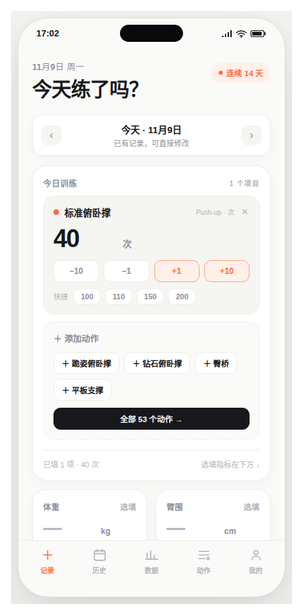
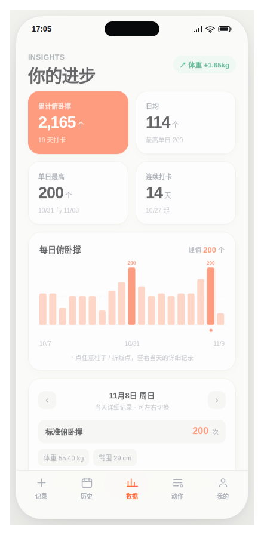
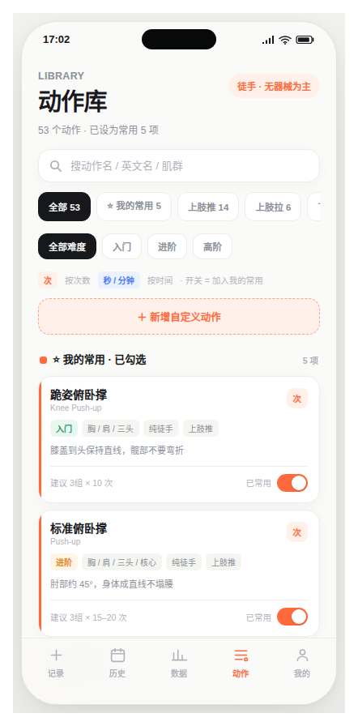

# PUSHUP · 俯卧撑训练记录

> 每天 3 秒记完的俯卧撑训练记录 App。单文件 PWA，纯前端、离线可用，数据只存在你自己的设备上。

**在线体验**：https://a921090d771d09e84.app.workbuddy.host/?sharecode=4IMFZU5IGF
（`?sharecode=` 是访问凭据，别删；手机浏览器打开后「添加到主屏幕」就跟原生 App 一样）

---

## 长什么样

| 记录页 | 数据页 | 动作库 |
|---|---|---|
|  |  |  |

更多各版本的界面截图在 [`预览图/`](./预览图)，可点击的历代原型在 [`原型历史/`](./原型历史)。

---

## 功能

- **记录**：一天可记多个动作；大数字输入 + 快捷值 + −10 / −1 / +1 / +10 步进按钮；体重、臂围选填；日期左右切换可补录任意一天。默认常用里 3 项是俯卧撑。
- **历史**：月历热力（有记录的日子直接显示次数）、点日期看详情或补录、按月汇总、倒序列表、可编辑删除。
- **数据**：累计 / 日均 / 最高 / 连续天数四张 KPI 卡，俯卧撑柱状图、体重折线、臂围对比、每日目标环；柱子与折线点可点选查看当天明细，体重折线可左右滑动看每次测量值。
- **动作**：53 个内置自重动作（上肢推 / 上肢拉 / 下肢臀腿 / 核心稳定 / 全身心肺），支持中英文搜索、分类与难度筛选；「⭐ 我的常用」独立分组；可新增自定义动作与分类；「完成」按钮只在有改动后出现。
- **我的**：统计概览、导出 JSON 备份 / 导出 CSV、导入备份或 `11.08 俯卧撑200 体重55.40 臂围29` 这样的文本；**清空数据**（二次确认后清完全自动刷新，回到空白状态）；浅色 / 深色 / 跟随系统三档主题；关于页与作者信息。
- **开屏**：每次打开全屏展示一句励志语，12 句固定词库轮换，底部一句由实时数据算出的激励文案；2.6 秒自动进入，点任意处跳过。
- **PWA / APK**：`manifest.webmanifest` + `sw.js` + 全套图标，可安装到主屏幕、断网完整可用，适配刘海与底部安全区；APK 使用系统真实状态栏，底色与图标颜色跟随 App 主题（浅色 / 深色 / 跟随系统）自动融合，不再绘制模拟状态栏。

---

## 在自己电脑上跑起来

```bash
# 进入本仓库根目录（index.html 所在目录）
python -m http.server 8080
# 或者： npx serve -l 8080
```

浏览器打开 **http://localhost:8080** 。此时 Service Worker 正常注册，离线可用。

> 直接双击 `index.html` 用 `file://` 打开也能看，但离线缓存和部分浏览器存储会受限，只适合看样子，别拿它正式记数据。

**手机上同一 WiFi 打开**：`python -m http.server 8080 --bind 0.0.0.0`，手机访问 `http://电脑IP:8080`（非 localhost 时浏览器不给装 PWA，但打开使用没问题）。

---

## 数据说明（重要）

- 数据只存在打开它的那个浏览器 / 手机的 `localStorage`，**不上传、不同步、无账号、无后端**。
- **全新安装即为空白，不预置任何训练记录**。旧版本覆盖安装时，若本地还留着「与出厂演示数据完全一致、用户从未修改过」的记录，会自动清掉；只要录入 / 修改过任何一条，整份数据一律保留，不会误删。线上版、本地版、APK 三份数据各自独立。
- 换设备请在「我的 → 导出备份 JSON」下载，再到目标端「我的 → 导入数据」粘贴；卸载 App / 清除浏览器数据会丢数据，记得先导出。
- 「我的 → 清空数据」会删除全部本地数据并**自动刷新页面**，回到空白状态；此操作不可恢复，务必先导出备份。

---

## 目录结构

```
.
├── index.html                  ★ 正式版 v1.0，HTML + CSS + JS 全内嵌，零外部依赖
├── manifest.webmanifest         PWA 清单
├── sw.js                       离线缓存（pushup-v2）
├── icons/                      6 个图标（默认橙色 P 标 + logo.svg 源文件）
├── package.json                Capacitor 依赖
├── capacitor.config.json       Android 打包配置（appId / webDir）
├── .github/workflows/          GitHub 云端自动打包 APK 的工作流
├── docs/                       交接文档、本地运行与 APK 打包指南、给 AI 的提示词
├── 原型历史/                   v0.1 ~ v0.6 共 6 个可点击原型
├── 预览图/                     41 张各版本页面截图
└── README.md
```

历史版本全部保留，**以根目录的 `index.html` 为准**，别拿 v0.x 当最新。

---

## 技术

- 单文件 PWA，约 93 KB，零 CDN、零依赖、零构建步骤，断网也能完整渲染
- 图表为手写 SVG，不依赖图表库
- localStorage 键：`fitness_proto_v03` / `fitness_favs_v03` / `fitness_theme_v03` / `fitness_custom_v04` / `fitness_cats_v04` / `fitness_splash_v04`
- 设计：奶油白 `#FAFAF8` + 纯白大圆角卡片 + 墨黑 `#1C1D21` 数字 + 珊瑚橙 `#FF6A3D`，移动端优先

---

## 打包 Android APK

仓库里已经配好 GitHub 云端自动打包：[`.github/workflows/build-apk.yml`](./.github/workflows/build-apk.yml)。

**怎么拿到安装包**

1. 打开仓库的 **Actions** 页 → 左侧选「打包 PUSHUP APK」→ 点 **Run workflow**（推荐）；或者改动 `index.html` / `icons` / `capacitor.config.json` 后推到 `main` 自动触发。
2. 等构建完成（约几分钟），在该次运行的 **Artifacts** 里下载 `PUSHUP-APK`；同一个包也会发到仓库 **Releases**，手机浏览器可直接下载。
3. 把 `PUSHUP-v1.0.apk` 传到手机，允许「未知来源」后安装即可。这是带 debug 签名的可安装包，不需要额外配置。

**打包原理**：用 Capacitor 做 WebView 壳 + 本地 assets —— 构建时把 `index.html`、`manifest.webmanifest`、`sw.js`、`icons/` 复制成 `www/`（`webDir`），关掉这个副本的 Service Worker 注册（资源本来就在本地），把桌面图标换成默认橙色 P 标，再跑 `gradlew assembleDebug`。整个 App 都塞进 APK，离线完整可用，`localStorage` 正常存储数据。

**状态栏配色融合**：APK 里用 `@capacitor/status-bar` 把系统状态栏底色设为与页面一致（浅色 `#FAFAF8` + 深色图标，深色 `#15171A` + 浅色图标），开屏页阶段用深色；切换主题或系统切深浅色时同步更新。网页版 / PWA 由浏览器管理，能力检测后自动跳过。启动瞬间由原生主题画的状态栏在构建时统一改成深色，避免加载期出现割裂。

> ⚠️ 插件的 `setStyle` 枚举名与字面直觉相反：Android 源码里 `setStyle("DARK")` → `setAppearanceLightStatusBars(false)` → **白色图标**（配深底）；`setStyle("LIGHT")` → `true` → **深色图标**（配浅底）。写反就会出现「白底 + 白图标，状态栏看不见」。因此代码里不手写枚举，统一用 `sbStyleFor(color)` 按底色亮度自动反推图标色；三个原生调用串行执行（`setOverlaysWebView(false)` 会恢复上一次记录的底色），并在 220ms 后补设一次图标色以防部分 ROM 重置。

**固定签名 · 可直接覆盖升级**：仓库 `signing/debug.keystore` 是固定的 debug 密钥，构建流程会把它复制到 runner 的 `~/.android/debug.keystore`，因此每次出包签名一致；`versionCode` 用构建号递增。**从固定签名版开始，往后新包可直接覆盖安装，不用卸载**。注意：这把私钥在公开仓库里、仅用于自用 debug 包，切勿用于上架或正式签名；在它启用之前构建的包签名不同，升级到固定签名版仍需卸载一次（先在旧版导出 JSON 备份，装好新版再导入）。

不要用 TWA / Bubblewrap：线上地址带 `?sharecode=` 访问控制，做不了 Digital Asset Links 域名验证。想在自己电脑上手动打包，见 [`docs/本地运行与打包.md`](./docs/本地运行与打包.md) 第 3 节。

---

## 开启 GitHub Pages（可选）

仓库 Settings → Pages → Source 选 `main` / 根目录 → Save，稍等即可访问 `https://<用户名>.github.io/PUSHUP/`。
页面里的图标、manifest 都是相对路径，放子目录也能正常用。

---

**作者**：再多吃一口饭 · [酷安主页](https://www.coolapk.com/u/2456761)
**版本**：v1.0 正式版 · 2026-11-09（修订：默认空白数据、状态栏图标自适应反色、清空数据并自动刷新、固定签名可覆盖升级）
